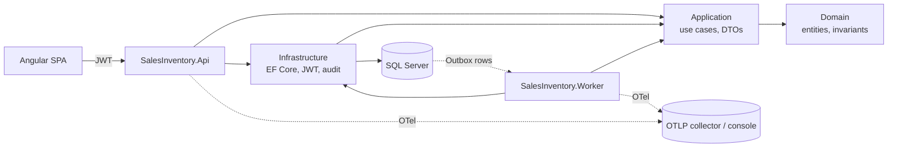
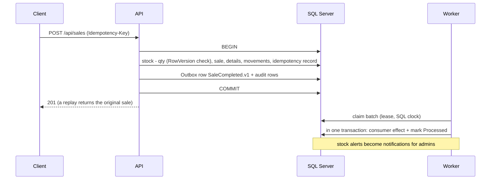

# SalesInventory

[](https://github.com/chinixdev/sales-inventory-app/actions/workflows/ci.yml)


A sales and inventory management system: ASP.NET Core Web API, Angular SPA and a background Worker, on SQL Server. It is a portfolio project focused on the hard parts of transactional systems: atomic stock updates, safe retries, asynchronous processing, auditability and operability.

> **Validation status.** The code is implemented, but the .NET 10 backend has **not yet been built or tested end to end** by the author of this change set (the authoring environment only had .NET SDK 8). The Angular app was built and its test suite run locally. See [Validation status](#validation-status) for what is implemented versus verified, and [docs/LOCAL_SETUP.md](docs/LOCAL_SETUP.md) (Spanish) to validate it yourself.

## Business problem

Small retailers need to sell products without overselling, keep a reliable stock history, and know who changed what. The hard cases are operational: two cashiers selling the last unit at once, a client retrying a request after a network failure, a failure after a sale is saved but before follow-up work (alerts) runs, and a background process that dies halfway.

## Features

- **Catalog:** categories and products (SKU, price, minimum stock). Admin-only writes, soft delete when history exists.
- **Inventory:** stock entries and adjustments, with a movement ledger (previous and new stock per movement).
- **Sales:** multi-item sales; prices and totals are computed on the server; stock is deducted in the same transaction.
- **Idempotent sales:** `Idempotency-Key` header; replaying a request returns the original sale, a changed body under the same key returns `409`.
- **Asynchronous processing:** every confirmed sale publishes a `SaleCompleted.v1` event through a Transactional Outbox, consumed by a Worker that raises low-stock and out-of-stock notifications for administrators.
- **Audit trail:** automatic, allow-list based audit of products, categories, sales, stock movements and user changes (Admin-only read API and UI).
- **Operations:** Outbox event monitor with manual requeue, notification center, and a system health screen (SQL Server, Worker heartbeats, event backlog).
- **Roles:** Admin and Seller (RBAC enforced on the server).

## Tech stack

| Area | Technology |
|---|---|
| Backend | .NET 10, ASP.NET Core Web API, Worker Service (`BackgroundService`) |
| Data | Entity Framework Core 10, SQL Server, EF migrations |
| Frontend | Angular 21 (standalone components, Signals, zoneless, lazy routes), TypeScript |
| Auth | JWT Bearer (HS256), PBKDF2 password hashing |
| Observability | OpenTelemetry (traces, metrics, logs), OTLP optional |
| Tests | xUnit, FluentAssertions, `WebApplicationFactory` against real SQL Server, Vitest (`ng test`), k6 |
| CI | GitHub Actions |

## Architecture

Clean Architecture: dependencies point toward the domain.



### Sales, inventory and asynchronous flow



## Technical decisions

- **ACID transactions.** Stock, sale, details, movements, idempotency record, Outbox message and audit rows are written in one transaction, using the EF execution strategy (`EnableRetryOnFailure`). The whole unit of work is retried from a clean change tracker, never partially.
- **Optimistic concurrency.** `Product.RowVersion` (`ROWVERSION`) prevents lost updates and overselling; a conflict surfaces as `409`.
- **Idempotency.** A unique record per user, operation and key stores a hash of the request. Same key and body returns the original sale without touching stock; a concurrent duplicate is resolved against the winner.
- **Transactional Outbox.** The event is stored in the same transaction as the sale, so a sale never exists without its event and no event exists for a rolled-back sale.
- **Background Worker.** Multiple instances can run in parallel: messages are claimed atomically (`UPDLOCK, READPAST`), guarded by a lease and `RowVersion`, using the SQL Server clock (`SYSUTCDATETIME()`). Failures use exponential backoff with jitter and end in a `Failed` state that an admin can requeue.
- **Idempotent consumers.** `ProcessedEvents` (event id + consumer) makes at-least-once delivery safe; consumer effects and message completion commit together.
- **Audit.** Implemented in `SaveChanges` rather than an interceptor so audit rows share the transaction and carry database-generated ids. Only an explicit property allow-list is recorded (no password hashes, tokens or idempotency keys); the actor comes from the authenticated JWT or is `System` for the Worker.
- **Trace propagation.** The W3C `traceparent` is stored on the Outbox message and the Worker links its span to the original request (`ActivityLink`). Old events without context are still processed.

## Security

- JWT validation of issuer, audience, signature and lifetime; no secrets in the repository (User Secrets or environment variables).
- Server-side RBAC with `[Authorize(Roles = ...)]`; the acting user is always taken from the token, never from the request body.
- Admin-only endpoints: audit logs, Outbox monitor, system health.
- Error responses and health endpoints do not expose exceptions, connection strings or payloads; Outbox errors are sanitized and truncated.

## Observability and operations

- OpenTelemetry for ASP.NET Core, HttpClient and SQL Server (statement text is not captured), plus business spans (sale creation, outbox persist/claim/process, notifications) and metrics (confirmed sales, idempotency replays, concurrency conflicts, events processed/failed/retried, durations). Metrics avoid high-cardinality labels. Console export in Development, OTLP when `Telemetry:OtlpEndpoint` is set.
- `/health/live` and `/health/ready` (database); `/health` is kept as liveness.
- `GET /api/admin/system-health` (Admin): SQL Server status, Worker instances from persisted heartbeats, event counts, oldest pending age and last-24h totals. A heartbeat proves the process is alive, not that events are being processed, so the processing state is reported separately. If SQL Server is unreachable the endpoint answers `Degraded` with unavailable sections as `null`.

## Testing

| Level | Location | Notes |
|---|---|---|
| Unit | `backend/tests/SalesInventory.UnitTests` | Domain rules, services, audit, telemetry, health evaluation |
| Integration | `backend/tests/SalesInventory.IntegrationTests` | Real SQL Server; each run creates and drops its own database |
| Frontend | `frontend` (`ng test`) | Vitest component and service tests |
| Performance | `tests/performance` | k6 smoke, load, stress and concurrency scripts with integrity checks |
| CI | `.github/workflows` | `ci.yml` (build, unit, frontend, integration on an ephemeral SQL Server); `performance.yml` (manual, isolated) |

k6 thresholds are configurable initial values, not measured results.

## Repository layout

```
backend/
  SalesInventory.sln
  src/  Domain, Application, Infrastructure, Api, Worker
  tests/ UnitTests, IntegrationTests
frontend/            Angular SPA (core, features, shared, layout)
tests/performance/   k6 scripts
database/            reference SQL script (EF migrations are the source of truth)
docs/                architecture, business rules, database design, API, local setup
.github/workflows/   ci.yml, performance.yml
```

## Getting started

Full Windows walkthrough (Spanish): [docs/LOCAL_SETUP.md](docs/LOCAL_SETUP.md). Summary:

**Prerequisites:** .NET SDK 10, Node.js LTS with npm, SQL Server (Express, Developer or LocalDB), `dotnet-ef` (`dotnet tool install --global dotnet-ef`).

```bash
# 1. Secrets (never committed)
dotnet user-secrets set "ConnectionStrings:DefaultConnection" "<your connection string>" --project backend/src/SalesInventory.Api
dotnet user-secrets set "Jwt:Issuer" "SalesInventory.Api" --project backend/src/SalesInventory.Api
dotnet user-secrets set "Jwt:Audience" "SalesInventory.Client" --project backend/src/SalesInventory.Api
dotnet user-secrets set "Jwt:SigningKey" "<random 32+ byte key>" --project backend/src/SalesInventory.Api
dotnet user-secrets set "DevelopmentAdmin:Email" "<admin email>" --project backend/src/SalesInventory.Api
dotnet user-secrets set "DevelopmentAdmin:Password" "<admin password>" --project backend/src/SalesInventory.Api

# 2. Database
dotnet ef database update --project backend/src/SalesInventory.Infrastructure --startup-project backend/src/SalesInventory.Api

# 3. Run
dotnet run --project backend/src/SalesInventory.Api        # http://localhost:5235
dotnet run --project backend/src/SalesInventory.Worker     # optional: processes the Outbox
cd frontend && npm ci && npm start                         # http://localhost:4200
```

The Worker shares the API's User Secrets. Run the tests with `dotnet test backend/SalesInventory.sln` (integration tests need `SALESINVENTORY_TEST_CONNECTION` or the Development connection string) and `npx ng test --watch=false` in `frontend`.

## Screenshots

No screenshots have been added yet. They should be taken from the running application and placed in `docs/screenshots/`.

## Validation status

| Area | Implemented | Verified |
|---|---|---|
| Angular app | Yes | `ng build` and `ng test` run locally and passed at the last run |
| Backend (.NET 10) | Yes | **Not yet built or tested with .NET 10** (reviewed statically only) |
| EF migrations | Yes | Hand-written for the latest V2 migrations; regenerate or compare with `dotnet ef` before relying on them |
| Integration and k6 suites | Yes | Not yet executed |
| GitHub Actions workflows | Yes | Not yet run on GitHub |

## Known limitations

- No user administration screen or endpoints; the initial Admin comes from the Development seeder.
- JWTs cannot be revoked and there are no refresh tokens.
- Sellers can list and read all sales (no per-user isolation).
- Concurrent stock alerts for different events on the same product can still produce duplicate unread notifications; a filtered unique index is planned.
- No payments, invoicing, returns or multi-currency (amounts are shown in PEN).
- The dashboard aggregates sales in the browser; there is no aggregate endpoint.

## Further documentation

[Architecture](docs/architecture.md) · [Business rules](docs/business-rules.md) · [Database design](docs/database-design.md) · [API endpoints](docs/api-endpoints.md) · [Local setup (ES)](docs/LOCAL_SETUP.md) · [Performance tests](tests/performance/README.md)

## License

MIT. See [LICENSE](LICENSE).
