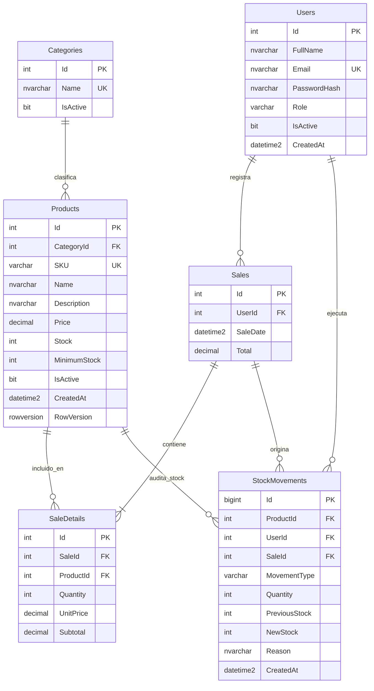

# Diseño de Base de Datos — SalesInventoryDb

## 1. Descripción General

La base de datos `SalesInventoryDb` implementa el modelo relacional normalizado para soportar operaciones comerciales de ventas y control estricto de inventario en tiempo real. 

El diseño prioriza la **integridad de datos a nivel de motor de base de datos** mediante el uso exhaustivo de restricciones (`CHECK`, `UNIQUE`, `FOREIGN KEY`), control de concurrencia optimista (`ROWVERSION`) e índices diseñados para consultas frecuentes.

---

## 2. Diagrama Entidad-Relación (ER)



---

## 3. Diccionario de Datos Detallado

### 3.1. Tabla: `dbo.Users` (Usuarios)
Almacena los usuarios del sistema autorizados para registrar ventas o administrar inventario.

| Columna | Tipo de Dato | Nulo | Por Defecto | Restricciones / Índices | Descripción |
|---|---|:---:|---|---|---|
| `Id` | `INT` | NO | `IDENTITY(1,1)` | `PK` Clave primaria | Identificador único del usuario. |
| `FullName` | `NVARCHAR(120)` | NO | | | Nombre completo del usuario. |
| `Email` | `NVARCHAR(255)` | NO | | `UQ_Users_Email` (UNIQUE) | Correo electrónico para acceso al sistema. |
| `PasswordHash` | `NVARCHAR(255)` | NO | | | Hash criptográfico de la contraseña. |
| `Role` | `VARCHAR(20)` | NO | | `CK_Users_Role` (`'Admin'\|'Seller'`) | Rol funcional asignado. |
| `IsActive` | `BIT` | NO | `1` | | Estado para borrado lógico. |
| `CreatedAt` | `DATETIME2` | NO | `SYSUTCDATETIME()` | | Fecha y hora UTC de alta del registro. |

---

### 3.2. Tabla: `dbo.Categories` (Categorías)
Organiza y agrupa los productos del catálogo.

| Columna | Tipo de Dato | Nulo | Por Defecto | Restricciones / Índices | Descripción |
|---|---|:---:|---|---|---|
| `Id` | `INT` | NO | `IDENTITY(1,1)` | `PK` Clave primaria | Identificador único de la categoría. |
| `Name` | `NVARCHAR(100)` | NO | | `UQ_Categories_Name` (UNIQUE) | Nombre único de la categoría. |
| `IsActive` | `BIT` | NO | `1` | | Indicador de disponibilidad operativa. |

---

### 3.3. Tabla: `dbo.Products` (Productos)
Catálogo de bienes comerciales con su nivel de existencias y control de concurrencia.

| Columna | Tipo de Dato | Nulo | Por Defecto | Restricciones / Índices | Descripción |
|---|---|:---:|---|---|---|
| `Id` | `INT` | NO | `IDENTITY(1,1)` | `PK` Clave primaria | Identificador único del producto. |
| `CategoryId` | `INT` | NO | | `FK_Products_Categories`, `IX_Products_CategoryId` | Relación con categoría. Regla `ON DELETE RESTRICT`. |
| `SKU` | `VARCHAR(40)` | NO | | `UQ_Products_SKU` (UNIQUE) | Código alfanumérico único de inventario. |
| `Name` | `NVARCHAR(150)` | NO | | | Nombre comercial del producto. |
| `Description`| `NVARCHAR(500)` | SÍ | `NULL` | | Descripción técnica o comercial detallada. |
| `Price` | `DECIMAL(18,2)` | NO | | `CK_Products_Price` (`> 0`) | Precio unitario de venta. |
| `Stock` | `INT` | NO | `0` | `CK_Products_Stock` (`>= 0`) | Cantidad física disponible. |
| `MinimumStock`| `INT` | NO | `5` | `CK_Products_MinStock` (`>= 0`) | Nivel mínimo de reabastecimiento. |
| `IsActive` | `BIT` | NO | `1` | | Estado de activación del producto. |
| `CreatedAt` | `DATETIME2` | NO | `SYSUTCDATETIME()` | | Fecha de creación del registro en UTC. |
| `RowVersion` | `ROWVERSION` | NO | Autogenerado | Token de concurrencia | Incrementado automáticamente por SQL Server para evitar colisiones. |

---

### 3.4. Tabla: `dbo.Sales` (Ventas)
Encabezado de la transacción comercial.

| Columna | Tipo de Dato | Nulo | Por Defecto | Restricciones / Índices | Descripción |
|---|---|:---:|---|---|---|
| `Id` | `INT` | NO | `IDENTITY(1,1)` | `PK` Clave primaria | Número consecutivo de venta. |
| `UserId` | `INT` | NO | | `FK_Sales_Users`, `IX_Sales_UserId` | Vendedor responsable. Regla `ON DELETE RESTRICT`. |
| `SaleDate` | `DATETIME2` | NO | `SYSUTCDATETIME()` | `IX_Sales_SaleDate` | Fecha y hora UTC del cierre de la venta. |
| `Total` | `DECIMAL(18,2)` | NO | | `CK_Sales_Total` (`> 0`) | Monto total consolidado de la venta. |

---

### 3.5. Tabla: `dbo.SaleDetails` (Detalle de Ventas)
Líneas de productos asociados a una venta.

| Columna | Tipo de Dato | Nulo | Por Defecto | Restricciones / Índices | Descripción |
|---|---|:---:|---|---|---|
| `Id` | `INT` | NO | `IDENTITY(1,1)` | `PK` Clave primaria | Identificador del ítem vendido. |
| `SaleId` | `INT` | NO | | `FK_SaleDetails_Sales`, `UQ_SaleDetails_SaleProduct` | Venta asociada. Regla `ON DELETE CASCADE`. |
| `ProductId` | `INT` | NO | | `FK_SaleDetails_Products`, `UQ_SaleDetails_SaleProduct` | Producto vendido. Regla `ON DELETE RESTRICT`. |
| `Quantity` | `INT` | NO | | `CK_SaleDetails_Quantity` (`> 0`) | Unidades vendidas. |
| `UnitPrice` | `DECIMAL(18,2)` | NO | | `CK_SaleDetails_Price` (`> 0`) | Precio unitario acordado en la venta. |
| `Subtotal` | `DECIMAL(18,2)` | NO | | `CK_SaleDetails_Subtotal` (`= Quantity * UnitPrice`) | Importe de la línea. |

> **Nota:** La restricción `UQ_SaleDetails_SaleProduct` en `(SaleId, ProductId)` garantiza que un producto no figure repetido en distintas líneas de la misma venta.

---

### 3.6. Tabla: `dbo.StockMovements` (Movimientos de Inventario / Kardex)
Auditoría inmutable de todas las variaciones de inventario.

| Columna | Tipo de Dato | Nulo | Por Defecto | Restricciones / Índices | Descripción |
|---|---|:---:|---|---|---|
| `Id` | `BIGINT` | NO | `IDENTITY(1,1)` | `PK` Clave primaria | Identificador incremental del movimiento (tipo `BIGINT` para alta volumetría). |
| `ProductId` | `INT` | NO | | `FK_StockMovements_Products`, `IX_StockMovements_ProductDate` | Producto afectado. Regla `ON DELETE RESTRICT`. |
| `UserId` | `INT` | NO | | `FK_StockMovements_Users` | Usuario que ejecutó o autorizó la operación. |
| `SaleId` | `INT` | SÍ | `NULL` | `FK_StockMovements_Sales`, `IX_StockMovements_SaleId` | Referencia a la venta si el movimiento fue una salida (`OUT`). |
| `MovementType`| `VARCHAR(20)` | NO | | `CK_StockMovements_Type` (`IN`, `OUT`, `ADJUSTMENT`) | Naturaleza de la operación. |
| `Quantity` | `INT` | NO | | `CK_StockMovements_Quantity` (`> 0`) | Magnitud de la variación. |
| `PreviousStock`| `INT` | NO | | `CK_StockMovements_Stock` (`>= 0`) | Existencia antes del movimiento. |
| `NewStock` | `INT` | NO | | `CK_StockMovements_Stock` (`>= 0`) | Existencia resultante. |
| `Reason` | `NVARCHAR(300)` | NO | | | Motivo, justificativo u orden de compra asociada. |
| `CreatedAt` | `DATETIME2` | NO | `SYSUTCDATETIME()` | `IX_StockMovements_ProductDate` (DESC) | Fecha y hora del registro en UTC. |

### Restricciones Críticas en `StockMovements`:
- **`CK_StockMovements_Balance`**:
  ```sql
  (MovementType = 'IN' AND NewStock = PreviousStock + Quantity)
  OR
  (MovementType = 'OUT' AND NewStock = PreviousStock - Quantity)
  OR
  (MovementType = 'ADJUSTMENT' AND ABS(NewStock - PreviousStock) = Quantity)
  ```
- **`CK_StockMovements_SaleType`**:
  ```sql
  SaleId IS NULL OR MovementType = 'OUT'
  ```

---

## 4. Estrategia de Indexación

1. **`IX_Products_CategoryId`**: Optimiza las búsquedas de productos por categoría y la navegación del catálogo.
2. **`IX_Sales_SaleDate`**: Acelera reportes de ventas por rango de fechas (diario, semanal, mensual).
3. **`IX_Sales_UserId`**: Acelera consultas de rendimiento y comisiones por vendedor.
4. **`IX_StockMovements_ProductDate` (`ProductId, CreatedAt DESC`)**: Índice compuesto que permite reconstruir el historial cronológico inverso del producto (Kardex) a máxima velocidad.
5. **`IX_StockMovements_SaleId`**: Permite trazabilidad inmediata desde una venta hacia sus movimientos de stock correspondientes.
6. **`IX_StockMovements_UserId`**: Índice de soporte para la clave foránea y las consultas del historial por usuario.
